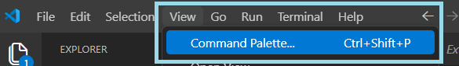
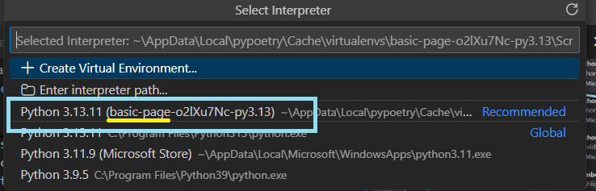
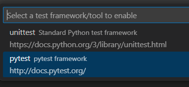
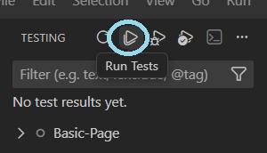

# Basic Page Project

## Learning Target: 
Students will be generate a **one pager** web project devoted to a topic of choice (a business, historical event or person, how to instructional page, travel destination, or something similar). This page will apply a variety of common HTML elements and apply basic CSS techniques to apply fonts and colors.

:soon:
---------
[top](#basic-page-project) | [learning target](#learning-target) | [instructions](#instructions) | [project requirements](#project-requirements) | [grading](#grading)

## Instructions:
Once you have accepted the assignment and have a copy of your repo...

### Project Setup

<b><i>* Testing Setup</i></b>

***NOTE**: this step is only necessary if you want to check to make sure you've met all your `HTML` and `CSS` requirements.*

* Open the Software Center and make sure the following apps are installed in the following order...
    - Python
    - Python Poetry
    - Python pip-system-certs
* Open your project in VSCode.
* Make sure that the Python Extension from Microsoft is installed
    
* Open the terminal (Terminal > New Terminal)
* Type: `poetry env activate`
* Type: `poetry update`
* Open the Command Palette
    - Click on the View Menu then select Command Palette
    
    *OR*
    - Type `CTRL` + `Shift` + `P`
* In the Command Palette...
    - Type: "Python: Select Interpreter"
    - Select the one that states basic-page and shows "poetry" on the side.
    

<b><i>* Testing your project using pytest</i></b>

***NOTE**: this too is only necessary to test your project to see if you meet all `HTML` and `CSS` coding requirements.

1. Click the Test Icon (a flask) and choose "Configure Python Tests"

    
2. Select the "pytest" test option

    
3. Select the tests folder

    
4. Click the run test icon

    
5. NOTE: you will fail tests until you begin coding and meeting requirements.

### Working on Your Project 

<b>Adding your Web Content</b>

1. Open your project in VSCode.
2. Create a file named `index.html` in the project folder.
3. Add the basic HTML code to `index.html`
4. Select a topic to explore where you have access to content (you do not have to write your own content).
    - choose a topic that you can break up into at least three sub-categories.
    - I recommend a favorite topic of yours that you are interested in or pick a unit of study that you have for another class.
5. In the body of `index.html` add the headers you plan to use.
    - Add a title using the most important heading tag.
    - In the `head` section, be sure to provide the same title in the `<title>` tag.
    - Add a sub-title (using the appropriate heading tag) to title each of your sections.
6. In each section add several paragraphs.
    - Each paragraph should be short and scannable.
    - One concise thought per paragraph.
    - No more than 4 sentences per paragraph.
    - Try including several singl-sentence paragraphs.
    - Do NOT use ` ` tags to "create" paragraphs (instead surround each paragraph with a '
' tag).

<b>Styling Your Page</b>

1. Add a `<style>` tag to the head.
2. In the `style` tag, target and style all content using a global selector (`body` or `html`).
    - change the font using either a ***[Google font](https://fonts.google.com/)***
    - Find and apply a good, high-contrast color combination for the background and text color
        + colors should go well with the selected topic
        + colors should have a really high contrast
        + use the [WebAIM Contrast Checker](https://webaim.org/resources/contrastchecker/) (the higher the contrast number the better - aim for 8 or higher)
3. Target and style the headers.
    - I recommend targetting all possible selectors as one.
    - Use another color for the text than you did in the global selector
        + All headers smaller than 18.7px must pass at Normal AA level
        + Headers at least 18.7px or larger may pass at Large AA level and still pass.

### Tracking Your Project History

<b>Using Git</b>

* As you work on your page, be sure to commit and push your changes using the following commands:
    - `git add *`
    - `git commit -m "concise explanation of what you did"`
    - `git push origin main`
* When you push your changes, check the repo to see if you passed tests.
* Once you've passed all tests, you will receive a green check and a 4/4 on the GitHub Classroom assignment.
* To turn in your assignment, take a screen capture of the final product as seen on a browser and turn that in.
    - Your teacher can see if you passed all tests
    - You will then receive a grade based on the scoring categories (see [scoring categories](#scoring-categories))

---------
[top](#basic-page-project) | [learning target](#learning-target) | [instructions](#instructions) | [project requirements](#project-requirements) | [grading](#grading)

## Project Requirements:
NOTE: for the course outcome related to `HTML` and `CSS`, your score will be calculated using the pytest tests.

<b>HTML Requirements</b>

* Your one-pager must be named `index.html`
* Must ***use appropriate headers*** according to semantic reasoning
* Must have at least ***two sections*** each labeled ***with an appropriate header***.
    - should be level 2 headings.
    - sub headings (level 3) are allowed, but only if you are breaking up a section into sub-sections 
* Must have at least six paragraphs in all (try to not put them all in one section).
* Must include at least two links that are
* Must pass HTML Validation (test your page using the [w3c validator](https://validator.w3.org/))

<b>CSS Requirements</b>
 

* Must ***use CSS*** as a style tag or external stylesheet to add styles.
    - ***You may NOT use the style attribute***
* ***Use a [Google Font](https://fonts.google.com/)*** (not default font)
    - Only 1 font-family is required
    - The font should be readable (avoid fancy and highly stylized fonts)
* ***Colors*** (background and foreground) ***must be applied*** to the page
    - add it to the `body` or `html` tag.
* Make sure it ***passes the [CSS Validator](https://jigsaw.w3.org/css-validator/)***
* Make sure it is readable (using a readable font and a high color contrast)

 

The **design** score, however, will be scored by your teacher

<b>Design Requirements</b>

* Above all, ***text must be readable*** (both through the font-face as well as in the use of high contrast colors)
* Use of fonts (no more than 2) and colors match the content of the site.
* All paragraphs of text are broken up into smaller chunks of text and  left-aligned or justified (NOT centered).
* The only text that may be centered is the headings (`h1` and/or `h2`)
* Typography follows most guidelines of the [Practical Typography Summary of Key Rules](https://practicaltypography.com/summary-of-key-rules.html) especially font size, line spacing, and line length.
* Layout is balanced without any irregular gaps that call attention to themselves. Any images should be floated so the text wraps around it.

-------

[top](#basic-page-project) | [learning target](#learning-target) | [instructions](#instructions) | [project requirements](#project-requirements) | [grading](#grading)

## Grading
Your project will receive a score based on the final criteria:
### For Proficient (3/4)

<b>Develop static websites</b>...
 

by structuring content with HTML and formatting it using CSS to create well-organized and visually appealing web pages.

* To score a 3/4, you must pass following pytests: `test_html` and `test_css`
* To get the extra point to bring it up to 4/4, you must pass `test_exceeds`

<b>Apply the design principles</b>...

of color, typography, balance, space, and visual hierarchy to **create visually appealing and user-friendly web pages**.

These tests will be measured by your instructor using the [design requirements guidelines](#design-requirements) above

    

<b>Apply project management skills</b>...

and use industry-standard tools** to plan, track, and complete development projects effectively.
* Uses Git to track work with multiple commits
* Commit messages are generally descriptive and related to the code changes
* Follows basic expectations (does not rely on file upload, commits reflect work progress)

<b>Demonstrate professionalism and employability skills</b> relevant to computer science careers.

* Turned project in on time and followed submission requirements (***self-awareness***)
* Content is appropriate for a school/professional audience (**self-awareness** / **resilience**)
* Uses clear and appropriate naming and structure (for example: index.html, meaningful link text and headings) (**digital literacy**/ **communication**)
* No major grammar/spelling errors; text and links clearly communicate purpose to a user (**communication**)

### For the Win (4/4)
Please meet the following requirements in order to score a 4/4 in each of the following course outcomes:

<b>Develop Static Websites...</b>

* Add 1 3rd section, which means you will need to have...
    - at least 3 `h2` tags in all
    - at least 9 paragraphs in all
* Break up each section with a break tag (at least 2 in all)
* Make a font-pairing using Google fonts (see [Top 50 Google Font Pairings [Handpicked by Pro Designers]](https://www.pagecloud.com/blog/best-google-fonts-pairings))
* Pick a color palette for your page (from a site such as [coolers.co](https://coolors.co/) or  [Color Hunt](https://colorhunt.co/))
* Change the color on your headings (`h1` and `h2`) (so they are not the same as your normal text)
* There is a maximum paragraph width set in `em`s or `rem`s 
* Make sure any color combinations meet **Color Contrast at a Level AAA**
    - Most text must meet **Normal Level AAA**
    - Large text may meet **Large Level AAA**
    - According to the [Color Contrast Checker](), *"Large text is defined as ...**18.66px and bold or larger**, or ...**24px or larger**."*

<b>Apply Design Principles...</b>

* Make sure the colors are from a color palette and they look good.
* Make sure the colors meet color contrast (see above).
* Make sure text is readable, and the fonts do not compete with the theme of the content.
* Make sure text is readable, and the paragraphs are not too wide.
* Make sure paragraphs are not centered text

<b>Apply Project Management Skills</b>

* Uses Git consistently throughout development with purposeful, well-timed commits
* Commit messages are clear, concise, and follow a consistent naming convention
* Commits accurately reflect meaningful changes and demonstrate an organized workflow

<b>Demonstrate Professionalism and employability skills</b>

* Turned project in on time and fully met all requirements without reminders (self-awareness)
* Content is consistently appropriate, purposeful, and demonstrates awareness of a real-world audience (self-awareness)
* Naming and structure are consistently clear and intentional, reflecting strong use of basic development conventions (digital literacy / communication)
* Writing is polished, clear, and free of errors, making the page easy to understand and navigate (communication)

[top](#basic-page-project) | [learning target](#learning-target) | [instructions](#instructions) | [project requirements](#project-requirements) | [grading](#grading)
